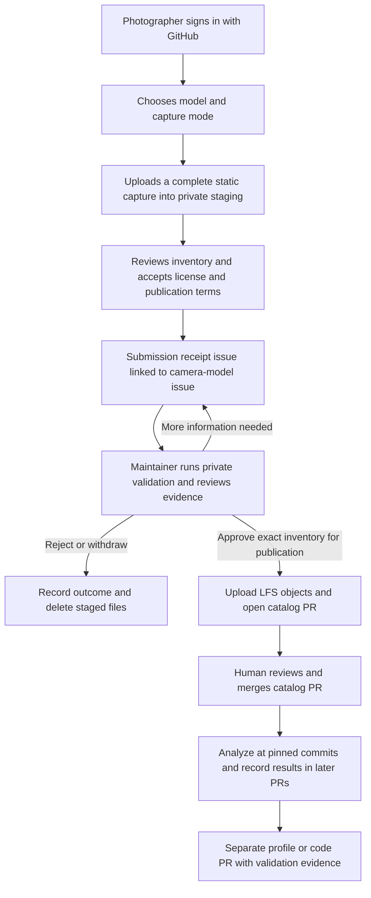
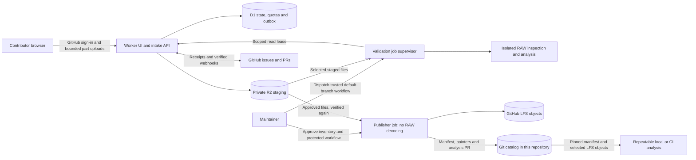

# ADR 0001: Community capture submissions and a reproducible sample catalog

- **Status:** Proposed; this PR is for discussion and must not be merged automatically.
- **Date:** 2026-11-01
- **Scope:** Contributor intake, publication, catalog storage and analysis provenance.
- **Repository:** `Niklas-labs/lightroom-pixel-shift-plugin`, including the catalog initially.
- **Implementation:** None in this ADR. Accepting it authorizes a direction; rollout still requires the gates below.

## 1. Problem and intended outcome

A photographer should be able to contribute a capture without understanding camera
profiles, reverse engineering, Git or Git LFS. Maintainers do the configuration and
coding work. Contributions become a licensed, reviewable corpus from which we can
investigate cameras and repeat validation as the engine changes.

A successful upload is evidence to investigate, not a declaration of camera support.
A sample can be useful even when our decoder cannot yet open it or our current
profile schema cannot express its capture mode. Failures and inconclusive analysis
must remain visible alongside successful results.

We need two distinct review boundaries: permission to publish a particular capture,
and review of the PR that adds it to the catalog. After publication, subsequent
analysis and camera-support changes receive their own PRs.

## 2. Requirements and how the proposal meets them

| Requirement | Proposed response |
| --- | --- |
| Photographers submit files, not implementation work | A browser flow: sign in, choose a capture, upload, accept contribution terms, follow a GitHub issue. No fork, Git installation, PAT or hand-written manifest. |
| Strong GitHub identity and issue linkage | Authenticate with GitHub; record stable numeric user/repository/issue IDs. Each submission has a receipt issue linked to one canonical camera-model issue. |
| Original files are versioned with the project | Accepted RAW files and large reference/derived images use Git LFS in this repository. Manifests, licenses and analysis records use ordinary Git. |
| Fetch only the evidence a job needs | Resolve a manifest at a pinned commit; fetch the LFS paths for selected captures or models, verify hashes, then analyze. Ordinary builds do not fetch the corpus. |
| Publicly reusable contributions | Require an explicit grant under `MIT OR Apache-2.0`, attribution and rights attestation tied to the exact file inventory. Reject private-use-only, research-only and noncommercial restrictions. |
| Review before expensive or public ingestion | Private, bounded R2 staging; maintainer-controlled validation and approval before LFS publication. A public catalog PR itself counts as publication. |
| Repeatable, inspectable analysis | Versioned schemas and tools, immutable input hashes and append-only run records in Git. Human interpretation is recorded separately from measurements. |
| A partially manual pipeline is useful immediately | Maintainers explicitly dispatch validation/publication workflows and review PRs. No AI agent or automatic profile inference is required. |
| Large captures survive interruptions | Resumable multipart uploads and incremental hashing; no whole-file buffering in the browser or Worker. |
| Uploads cannot silently become code execution or unlimited storage | Byte/count/concurrency reservations, isolated parsing, distinct publication credentials and protected branches. |
| The system can recover from interruptions | Persistent state, idempotent operations, explicit expirations and reconciliation with GitHub and R2. Git remains sufficient to use an accepted catalog if the intake app disappears. |

### Initial capture contract

Start with **one complete Sony 4-shot or 16-shot Pixel Shift sequence per submission**,
from a tripod, of a static scene with fine detail and useful tonal/color variation.
Require original, unmodified RAW bytes, a declared camera model and capture mode,
and a short account of capture conditions. Preserve the complete sequence, including
frames that do not merge well; do not silently select the best subset.

An unsupported Sony model is a valid research candidate. Missing decoder support is
an analysis result, not a reason to pretend the capture is corrupt. Malformed,
incomplete or mixed sequences need correction before catalog admission. Other
manufacturers, different frame counts and motion-specific capture recipes remain
future extensions to the intake schema, not capabilities implemented by this ADR.

Vendor-merged ARQ/DNG or lossless reference renders are **optional additional
evidence**, accompanied by tool/version/settings and a clear description of what
they represent. Do not require a contributor to buy software. Do not accept bundled
vendor executables, extracted proprietary profiles or unrelated archives. A reference
that exceeds the repository's LFS per-file limit is omitted with a recorded reason;
it is not silently resized or split. Its absence can leave a later validation claim
unproven without invalidating the original RAW contribution.

Motion scenes can later test alignment, ghosting and reference fallback. They are
not required to establish the first static reconstruction evidence for a model.

## 3. High-level flow



### 3.1 What the photographer does

1. Follow **Contribute a capture** from the repository or a camera-model issue.
   Sign in with GitHub; no installation on their own repositories is required.
2. Choose the model and mode, read a short static-scene checklist, and select the
   complete original sequence. The app shows proposed filenames, sizes, upload
   allowance and expiry before transferring bytes.
3. Hash and upload the files with progress, pause/retry and resume. After reopening
   the browser, reselect local files and verify their hashes before resuming;
   matching filenames alone is insufficient. No ZIP preparation is required.
4. Review the exact inventory and public attribution. Confirm ownership/permission,
   the contribution license, permission to process the staging upload, and eventual
   public redistribution, including embedded metadata. The app states: **the receipt
   issue is public immediately; the files stay private until publication approval**.
   Submit the capture.
5. Receive a stable app URL and a GitHub submission issue. Answer questions there;
   no YAML, profile editing or coding is expected. If files or relevant declarations
   change, submit a new revision and reaffirm the inventory rather than mutating
   the reviewed revision.
6. Follow the catalog PR and subsequent analysis through the linked issues. The UI
   distinguishes **Submitted**, **Needs information**, **Catalog PR open**,
   **Catalog accepted**, and **Camera validation pending**.

The app creates a **bot-authored submission receipt**, explicitly naming the
GitHub-authenticated submitter; it does not impersonate the photographer or require
them to grant repository write access. The receipt records the submission revision,
inventory digest, license-policy version and identity. It contains no R2 credentials
or signed download URLs. At submission time the listed SHA-256 values are declared
by the client; they become verified only after the trusted validation workflow
independently hashes the staged bytes. A mismatch blocks publication.

### 3.2 What the maintainer does

1. Triage the submission issue and link it to the canonical model issue. Check
   usefulness, rights/privacy concerns, duplicates and available storage budget.
2. Dispatch a trusted validation workflow against the immutable submission revision.
   It verifies hashes and inventories, then inspects/decodes in isolation where
   possible. Review the report and bounded private previews. Request corrections,
   reject, or mark a genuinely unsupported decoder/layout as needing investigation.
3. Explicitly approve **publication** of the exact inventory digest, including any
   public reports/previews, and launch the protected publisher. Approval is based on
   current maintainer authorization, not a label or the text of an issue comment.
4. Review the generated catalog PR: attribution/license, hashes, manifest, references,
   initial analysis state, validation provenance and permitted paths. Merge manually.
5. Investigate the model and propose profile/code changes with linked analysis runs.
   Record limitations rather than upgrading a model's support status from one upload.

Approval before step 3 matters: LFS uploads can incur storage charges before a PR is
merged, and files referenced by a branch in a public repository can be public before
merge. Closing a PR or deleting a pointer does not guarantee object deletion or
retract copies. The final PR is a review boundary, not a private moderation queue.

### 3.3 GitHub issue model

Use **one canonical support issue per exact model**, plus **one submission issue per
capture**, linked in both directions. Additional modes, firmware versions and RAW
compression variants are evidence within that model, not extra labels per model.
Use a small shared label vocabulary such as `camera-support`, `sample-submission`,
`needs-information` and `needs-analysis`; labels are navigation aids, not authority.

The service creates model issues idempotently using a unique normalized model key;
maintainers resolve aliases/duplicates. Initially a model without a verified catalog
identity may have a provisional key. Decoder observations and any later identity
correction are explicit reviewed facts, not a silent reassignment by the uploader.

Issues hold discussion and links. Git holds accepted sample identity, licenses,
analysis state and evidence. The app holds private intake operations. Neither an
editable issue body nor an app database row overrides merged catalog history.

## 4. Proposed decision

Use **Cloudflare Workers** for the small submission UI and API, **private R2** for
temporary sample bytes, and **D1** for transactional intake state, quota reservations
and an operation outbox. Use GitHub Apps for identity and repository integration,
with GitHub Actions as an initially **maintainer-dispatched** validation/publication
pipeline. Store accepted data with **Git LFS in the existing repository**.

No automatic camera-profile generation, support promotion, PR merge, or AI review is
part of this decision. The same pinned analysis tools must run locally and in CI.

## 5. Architecture and implementation boundaries



### 5.1 Identity, sessions and credentials

Use a repository-installed **intake GitHub App** with Issues write and necessary
metadata read access. Its web authorization flow obtains identity from GitHub's
API; store numeric user ID plus a display-login snapshot, never trust a submitted
login string. Use OAuth state and PKCE where supported, secure HttpOnly SameSite
session cookies, CSRF/origin checks on mutations and bounded session lifetimes.
User access tokens are used only to establish identity and are discarded after that
step; users do not provide PATs. Reauthentication precedes sensitive stale-session
operations. Automation writes receipts as the installation's bot.

Keep a **separate publisher GitHub App**, installed only on this repository, with
Contents and Pull requests write plus required metadata/issue reads. The intake
Worker must not hold this App's private key or a general repository-write token.
The publisher's key is retrieved by the protected publication workflow through the
existing OpenBao/GitHub OIDC pattern, under a separate policy from Apple signing.
No signing/notarization credentials are accessible to sample workflows.

Use short-lived, repository-scoped installation tokens. Contents permission is not
path-scoped by GitHub: the publisher's path/diff checks and branch protection are
necessary controls, not capabilities supposedly enforced by that token. Neither
App may bypass required human review or write the protected default branch directly.

A maintainer approval requires an allowlisted numeric user ID and a fresh check of
current repository maintain/admin permission. Record the approving identity, digest,
report identity and time; recheck at publication. GitHub webhook handlers verify the
signature over the raw body, repository/installation identity and event type, then
persist delivery IDs for deduplication. Labels, issue authorship, client assertions
and arbitrary comments never authorize publication.

### 5.2 Bounded uploads, freezing and verification

The initial implementation **streams multipart parts through the authenticated
Worker to R2**, rather than handing browsers general object-write credentials.
A proposed 32 MiB part size keeps each request below the configured ingress limit;
verify this on the deployed Cloudflare plan before enabling intake. Stream bodies
with backpressure and enforce the declared and actual part length. Do not call
whole-file `arrayBuffer()` or buffer a complete request before writing it.

The Worker owns multipart creation/completion/abort. Reserve bytes and permitted
part numbers transactionally before accepting data; require a current part lease,
limit concurrency, and make retries replace only the same authorized part. An
interrupted replacement must be reuploaded if R2 no longer has the previous part.
Use generated object keys and file IDs; user filenames never become object paths.
The browser uses incremental SHA-256, not a whole-file WebCrypto buffer. Persist
resume metadata server-side, not access tokens in browser storage.

On submission, stop new part leases, drain/cancel in-flight operations, complete the
exact uploaded inventory, check actual object sizes, and freeze a revision. No
upload route may replace a frozen object's bytes. The immutable intake digest is SHA-256 of UTF-8 canonical JSON (RFC 8785), with
files ordered by server-issued file ID. Its versioned schema covers file hashes/sizes,
capture declarations, submitter identity and license attestation, including the
exact versioned policy-text digest. Store GitHub numeric IDs losslessly; they are
identifiers, not user-supplied display names. Changing any of these requires a new
revision, new consent where relevant, and fresh approval. Multipart ETags are not
substitutes for SHA-256. The validator independently streams every file and checks
its hash against the attested inventory before any publication approval can succeed.

Prototype the complete streaming/length-enforcement path against deployed R2 before
committing to its implementation details: an oversized, short, canceled or timed-out
part must not become an apparently complete inventory entry. Reconcile the server's
part state before retrying; do not infer successful storage from a browser response.

This proxy adds Worker traffic and operational work. It gives us a place to enforce
actual byte limits and session authorization for each small part. Direct browser-to-R2
presigned multipart uploads are a later optimization only after proving equivalent
size, expiry and freeze controls. CORS and a short-lived signed URL alone do not
establish an upload quota; a leaked URL is a bearer capability. No public R2 bucket,
public listing, contributor-provided fetch URL, or arbitrary URL import is needed.

### 5.3 Operational state and recovery

Use explicit transitions, guarded by revision/version comparisons:

| State | Meaning and allowed next step |
| --- | --- |
| `draft` / `uploading` | Private, mutable inventory; upload within a reserved allowance. |
| `submitted` | Frozen, attested revision; receipt issue pending or recorded; hashes still awaiting independent verification. |
| `needs_information` | Maintainer requests clarification. Byte/declaration changes create a new revision. |
| `verified` | Matching hashes and a versioned validation report exist; technical limitations remain explicit. |
| `approved_for_publication` | Authorized maintainer approves this digest and report, within a bounded approval lifetime. |
| `publishing` | One leased, retryable publication operation owns the revision. |
| `pr_open` | Public catalog branch/PR exists; its exact commit and LFS inventory are recorded. |
| `merged` | GitHub merge and catalog contents are reconciled; accepted Git record is authoritative. |
| `rejected` / `withdrawn` / `expired` | No further private ingestion; staged data is cleaned up. Publication already performed cannot be promised reversible. |

Store private validation attempts as immutable receipts even on failure. An invalid
hash or parser crash is recorded as such, not `verified`; a verified byte inventory
may have `decoder_unavailable` as its technical outcome. Such a capture needs explicit
human justification for research admission and cannot imply camera validation.

D1 stores submission revisions, file/part inventories, reservations, operation leases,
identity/consent receipts, validation receipt references, approvals and GitHub IDs.
An outbox and scheduled reconciliation retry issue creation, workflow/result updates,
PR discovery and cleanup. External side effects use deterministic submission/revision
keys. For GitHub issue creation, persist intent before the request; after an ambiguous
timeout, search/reconcile its generated receipt marker before retrying. Resolve rare
duplicates explicitly rather than assuming distributed exactly-once delivery.

Publication similarly finds its existing branch/PR before retrying. Lost responses,
replayed webhooks or a workflow rerun must not create new capture directories or
silently change an approved revision. If the target branch changed, compare its
expected parent and stop/reconcile. A conflicting user-edited PR requires review;
the publisher must not force-push over it. A replacement PR does not get to reuse a
stale approval for different content.

### 5.4 Validation and publication are different jobs

**Validation** runs trusted, pinned workflow/tool code from the protected default
branch. Initially a maintainer dispatches it with a submission ID and revision;
uploads do not automatically spend unbounded Actions minutes. A read lease from
the intake API is bound to that inventory and a verified GitHub OIDC token: issuer,
audience, repository ID, workflow identity/ref, run identity, expiry and approved
execution context. Require the manual-dispatch event and trusted default-branch
workflow ref; check `workflow_ref` and, for reusable workflows, `job_workflow_ref`.
A token from a pull request, another workflow or a fork must fail. Its lease cannot
list or download other submissions. Tokens and signed URLs are never put into issue
text, Git, artifacts or logs.

This repository is public: Actions logs and ordinary workflow artifacts are not
private staging. Keep RAW bytes, previews, decoder stderr and detailed reports out of
public logs, Actions artifacts and shared caches. The supervisor returns bounded
reports/previews to a run-scoped intake result endpoint authenticated through OIDC;
it may create only that run's immutable result objects, not overwrite submitted
files. Public job output contains only opaque IDs and coarse outcomes. Use disposable
hosted runners, with no sample-data cache carried into later jobs.

The supervisor downloads only the selected files, verifies sizes/hashes, and starts
a disposable unprivileged sandbox for RAW parsing. Give that sandbox no GitHub/R2/
OpenBao tokens, OIDC request capability, network, Docker socket or repository-write
mount; bound its CPU, memory, disk, output size and runtime. Input is read-only.
Do not run contributor code, install contributed dependencies, execute metadata,
extract arbitrary archives, or check out a contributor's workflow. The supervisor
validates bounded machine-readable output; it never sources a generated script.
Return a structured outcome when decoding is unsupported or fails.

**Publication** uses a separate protected environment and trusted workflow. It checks
fresh authorization, exact approval/receipt hashes and available budget; downloads
and rehashes approved bytes, but does not parse RAW content. It generates manifests
and a narrow allowlisted diff from trusted templates, uploads LFS objects, then
commits pointers and opens a PR. Use Git LFS's supported transfer path; creating
pointer text with the GitHub Contents API alone does not upload file content.
Verify required LFS objects are available before declaring the PR ready.

Create an immutable publication plan covering the intake/report digests, base catalog
commit, publisher/template revision, exact proposed paths and their content hashes
(including license notices and public reports). Display its digest in the trusted
workflow's summary before the protected publication job is approved. Recreate and
compare that plan after any wait for environment approval; changed bytes or metadata
require fresh approval rather than silently refreshing the branch. Authentication receipts
remain assertions by the intake service, not cryptographic proof of copyright
ownership. Independent GitHub environment/PR review limits the service's publishing
authority, but cannot establish that a photographer's rights claim is true.

The App token creates the branch/PR so ordinary PR checks can run; do not rely on
recursive workflow triggers from a write performed with `GITHUB_TOKEN`. Pin Actions
and container images. No `pull_request_target` checkout of untrusted code is part
of this path. Required checks and CODEOWNERS protect catalog/licensing files;
profile and engine changes are excluded from sample-publication diffs.

Private reports/previews are visible only to the submitter and authorized maintainers
through the app. Render bounded raster previews, escape text, and serve originals as
attachments rather than executable HTML/SVG. At publication, revalidate allowlisted
report fields and include only reviewed outputs. A validator-produced artifact is
not trusted executable content just because a trusted workflow transported it.

### 5.5 Catalog layout and schemas

Proposed layout; these files are examples, not created by this ADR:

```text
samples/
  README.md
  schemas/{capture,analysis-status,analysis-run}.schema.json
  licenses/{policy-v1.md,MIT.txt,Apache-2.0.txt}
  sony/ilce-7cr/<capture-id>/
    manifest.yaml
    LICENSE.txt
    raw/source-0001.arw              # Git LFS; stable upload slot, not inferred shot index
    raw/...
    references/...                   # Git LFS, optional with provenance
    analysis/status.yaml
    analysis/runs/<run-id>/
      run.yaml
      results.json
      review.md
      previews/...                   # Git LFS, only if worth retaining
```

A capture manifest records schema version, stable capture/revision ID, exact original
file SHA-256 and size, logical role, model/capture declarations, observed identity
when known, optional reference provenance, numeric GitHub submitter/repository/issue
IDs, attribution, license expression and attestation/policy digest. Preserve declared
facts separately from decoder observations. LFS OIDs must equal the manifest hashes;
LFS sizes must equal declared byte counts. No staging access URL belongs in a manifest.
Use generated relative paths, never uploader-controlled absolute paths or symlinks.

The per-capture license notice identifies the contributor and the exact scope of the
grant. The versioned contribution policy and license texts are preserved in Git.
The root code-license transition is a **separate change**: this ADR does not relicense
existing code, samples or dependencies. The proposed sample grant is under both MIT
and Apache-2.0, allowing recipients to choose either; intake cannot launch until that
policy, full texts and the contributor-facing wording are reviewed and merged.

Use strict versioned YAML manifests, with JSON Schema validation after parsing and
runtime validation for cross-record invariants. Reject duplicate keys, unknown fields,
unsafe tags, non-finite values and path traversal. Rust tooling uses the project's
`serde-saphyr` conventions. `.gitattributes` explicitly tracks binary sample paths;
`.gitignore` exceptions for this catalog must coexist with the existing global RAW/
TIFF ignores. CI rejects accidentally committed full RAW blobs or missing LFS objects.

An accepted capture's original bytes, hashes and grant are immutable. Correct factual
metadata through a reviewed PR with an explanation. Replace a bad capture with a new
capture revision; never silently rewrite its originals or delete failed analysis.

### 5.6 Analysis state in Git

`analysis/status.yaml` is a reviewable summary such as `needs_analysis`,
`blocked_decoder`, `inconclusive`, `profile_proposed` or `validated_for_claims`.
It references the supporting run IDs, unresolved questions and the **specific claims**
covered: mode, compression, firmware/ISO range, crop, normalization, color, detail,
motion, RAM/disk parity and Lightroom host acceptance as applicable.

Each run adds a directory containing input capture/manifest digests, catalog commit,
engine/profile/tool/container revisions, commands and parameters, resource measures,
structured results and a human `review.md`. Record failed and inconclusive runs too.
Reanalysis adds a run and updates the summary in a PR; it never overwrites an old run.
A PR can contain observations from manual Sony/Lightroom comparisons, but identifies
manual steps, versions/settings and unavailable evidence. A checksum does not make a
subjective assessment reproducible; retain both measurements and interpretation.

For an initial intake run, record the existing base catalog commit plus the frozen
manifest digest; do not embed the as-yet-unknown SHA of the commit that will contain
that run. Later analyses pin commits where the capture already exists. Accepted
captures keep their failed/inconclusive analysis runs in Git. Rejected private intake
attempts retain only the bounded receipt/outcome under the intake retention policy;
this does not promise reproducibility of bytes we chose not to publish or retain.

Human reviewers decide whether evidence warrants a profile/code PR and a support
status change. Machine checks can establish integrity and measured properties, not
ownership, artistic suitability, every model variant, or Lightroom behavior that was
not tested. An AI agent can assist later but is not a gate or a source of authority.

### 5.7 Selective fetch and CI behavior

Keep pointer files and small metadata available without downloading every RAW.
For example, after setting `CATALOG_COMMIT` to the desired immutable catalog commit:

```sh
export GIT_LFS_SKIP_SMUDGE=1
git clone --filter=blob:none https://github.com/Niklas-labs/lightroom-pixel-shift-plugin.git corpus
git -C corpus checkout "$CATALOG_COMMIT"
git -C corpus lfs fetch --include='samples/sony/ilce-7cr/**' --exclude='' origin "$CATALOG_COMMIT"
```

A materialization command then checks out **only the manifest's required paths** from
the fetched objects and verifies SHA-256/size. Capture-specific include paths reduce
this further; clearing exclude rules avoids inherited configuration hiding inputs.
A job fails explicitly if a required LFS object is unavailable. It must not fall back
to using a pointer file as RAW data or the latest version of a different capture.

Normal engine/plugin CI checks out with LFS smudging disabled. Cheap catalog/schema
checks run on sample PRs; full analysis is selected and budgeted by capture/model.
Sample-only merges must not rebuild/sign the plugin or put RAW files into plugin or
source-distribution ZIPs. Design workflow path filters and required-check reporting
together so a skipped heavy job does not leave an otherwise valid PR unmergeable.

### 5.8 Budgets, retention, privacy and operations

Proposed initial policy values, configurable and subject to review:

| Limit | Initial proposal |
| --- | --- |
| Upload part | 32 MiB, reduced if deployment ingress limits require it |
| Per-file size | At most the repository's current Git LFS plan limit; check before upload |
| Per-submission allowance | 16 GiB / 24 files, including optional references |
| Active submissions | 2 per GitHub user; 64 GiB reserved across private staging |
| Concurrent uploads | 2 parts per submission, plus a global concurrency limit |
| Incomplete upload expiry | 24 hours, matching multipart-abort cleanup policy |
| Unpublished staged-object expiry | 30 days absolute; warn before expiry, then require reupload |
| Publication approval expiry | 7 days; renewed authorization must cover the same digest/report |
| Post-merge staging cleanup | After a verified LFS availability check, target 7 days; never treat R2 as the accepted corpus |

Deployment must set finite global Actions concurrency, validation time/byte budgets
and a publisher LFS storage/bandwidth budget. Fail closed if the current plan limit
or publication allowance is unknown; an operator can configure a conservative cap.
Git LFS is not made unlimited or free by making the repository public. Account-level
billing telemetry and historical/orphan LFS objects must be included in operational
budgeting, not just the sizes of files reachable from `main`.

Apply per-account and IP rate limits; add a challenge if abuse requires it. Reserve
allowances transactionally, release them after confirmed cleanup, and audit abandoned
parts/objects independently of app rows. R2 lifecycle policies backstop scheduled
cleanup. Retention can expire while waiting for a maintainer; communicate that limit
and do not promise indefinite staging. A public PR may remain reviewable through its
LFS pointers after the staging copy expires.

Before upload, explain that RAW files may contain GPS, serial numbers, faces and
copyrighted material. Require the contributor to choose files they can publish;
do not modify originals silently or promise that automated scanning proves safety.
Any report privacy filtering is explicit and does not alter the RAW hash. Store no
email address unless independently needed; expose only the chosen attribution and
necessary GitHub identity/provenance. Redact secrets and signed URLs in telemetry.

A contributor can withdraw before publication; abort multipart uploads, expire leases,
remove staged objects and record the outcome. After publication, handle removal
requests as maintainer work and remove current references where appropriate, while
being honest about Git history, public copies and prior license grants. Private
retention and public licensing are different promises. Restrictive or unverifiable
rights claims are rejected; sign-in and a checkbox cannot prove ownership.

Alert on quota pressure, cleanup failures, stale leases/outbox entries, expired
approvals, repeated parser crashes and GitHub/LFS failures. Back up D1 and keep
infrastructure, schemas, policy and deployment config in Git. Intake failure must
not stop ordinary use of the already accepted catalog.

## 6. Alternatives and consequences

| Alternative | Reason not chosen initially |
| --- | --- |
| Contributors open Git LFS PRs themselves | Good expert escape hatch, but requires Git/LFS, hosting/billing knowledge and correct manifests before they can contribute. A CLI can later use the same intake protocol. |
| GitHub issue attachments | Not a dependable multi-gigabyte, hash-verified, resumable catalog ingestion mechanism; does not establish LFS provenance. |
| GitHub Release assets | Useful distribution storage, but separates accepted original file versioning from Git LFS and the capture PR. The agreed catalog preference is LFS. |
| R2 as permanent authoritative corpus | Easier bulk storage, but accepted RAW versions would depend on a separate service instead of the agreed Git/LFS history. Keep R2 temporary. |
| One Worker/App with all repository permissions | Simpler credentials, but compromises of public intake could acquire repository-write capabilities. Separate intake from publication. |
| Direct presigned browser uploads from day one | Saves proxy traffic, but size enforcement, replay and freeze controls require an explicit proof before replacing the bounded part path. |
| Entire analysis inside Workers | Poor fit for native RAW decoders and full-size memory/CPU requirements. Workers orchestrate; isolated jobs analyze. |
| Automatic AI profile inference or merge | Not needed for repeatability and cannot establish support/rights from an arbitrary sample. Keep human conclusions reviewable. |
| A separate sample repository | May become necessary for size/ownership boundaries; keep the initial corpus here and preserve stable IDs/hashes to make later migration possible. |

The cost is a small submission service, two narrowly scoped GitHub integrations and
operational cleanup/budget management. The benefit is an easy contributor experience
without making the public repository an unmoderated upload endpoint. Git LFS still
has quota, availability and history-removal limitations; this decision accepts those
costs and requires measuring them, not concealing them behind the app.

## 7. Implementation sequence and acceptance gates

1. **Catalog and policy first:** review this ADR; adopt sample licensing/terms,
   schemas, `.gitattributes`/ignore rules, stable IDs, issue conventions and validation
   commands. Manually admit a known capture through a PR to prove the Git/LFS layout
   and selective-fetch path. No public intake until this works.
2. **Small private pilot:** deploy Worker UI/API, GitHub sign-in/receipt integration,
   D1 and private R2 with finite quotas, multipart resume, revision freezing and
   cleanup. Maintainers dispatch the private validator and protected publisher
   manually. Keep the pilot invite-only until the failure cases below pass.
3. **Repeatable analysis:** generate catalog/run/status PRs from pinned tools; retain
   manual interpretation and model-support review. Verify a fresh checkout can
   reproduce a run using only the chosen capture's LFS objects.
4. **Open intake:** publish concise capture guidance, deploy budget/expiry monitoring
   and a recovery runbook, then allow authenticated community submissions. Add more
   automation only when it preserves these contracts and is operationally useful.

Before public rollout, demonstrate:

- One unfamiliar Sony model can contribute a complete 4-shot and a 16-shot static
  set without profile code, Git, a PAT or repository permissions; unsupported decoder
  outcomes stay explicit and do not block useful research admission by default.
- Interrupted uploads resume in Safari and another current browser without whole-file
  buffering; changed local files, wrong sizes, extra parts and hash mismatches fail.
- Frozen revisions reject byte replacement, including a late in-flight upload;
  changed declarations/consent invalidate approvals. Stale sessions and unauthorized
  users cannot inspect another submission or approve publication.
- RAW parsing has no publishing/signing credentials or network. Malformed files,
  decoder crashes and resource exhaustion produce bounded failure receipts. Check
  the public Actions logs, artifacts and caches contain no private files, reports,
  decoder metadata or staging credentials.
- Retry issue/PR creation after ambiguous responses, replay a webhook, interrupt LFS
  upload and rerun a publisher: one logical capture/PR survives, unavailable objects
  block readiness, and partial/orphan storage is visible for reconciliation.
- Review a catalog PR before merge and prove that license, attribution, hashes,
  pointers and initial analysis state match its approved receipt. Neither App can
  merge it or bypass default-branch review. Changed PR content invalidates checks.
- Fetch only one model/capture at an older pinned commit and verify all bytes. Adding
  another model must not increase that job's LFS downloads. Normal CI/package ZIPs
  contain no sample RAW payloads.
- Expiry, withdrawal, quota exhaustion, revoked App access and GitHub/R2 outages have
  tested outcomes, recovery paths and contributor-visible status. Deleting Git
  references is never presented as guaranteed deletion of published copies.

## 8. Review points for this PR

The proposed decisions to challenge before acceptance are:

1. The static Sony 4/16-shot intake contract, with optional vendor/reference output.
2. Explicit dual MIT/Apache-2.0 sample grants, exact-inventory attestation, and the
   public-at-PR publication boundary.
3. Worker-proxied bounded multipart uploads initially, with presigned direct uploads
   deferred until equivalent controls are demonstrated.
4. Separate intake and publisher Apps, D1/outbox state, and manual protected Actions
   workflows rather than an automatic end-to-end agent.
5. The proposed quotas, 24-hour incomplete-upload / 30-day staging retention, and
   the resulting need for timely maintainer review.

## References

Platform references checked 2026-11-01; deployment must recheck plan-specific limits.
The architecture and policy choices above are proposals, not vendor guarantees.

- [Cloudflare Workers limits](https://developers.cloudflare.com/workers/platform/limits/)
  and [streaming best practices](https://developers.cloudflare.com/workers/best-practices/workers-best-practices/).
- [R2 multipart API from Workers](https://developers.cloudflare.com/r2/api/workers/workers-multipart-usage/),
  [S3 compatibility](https://developers.cloudflare.com/r2/api/s3/api/),
  [presigned URLs](https://developers.cloudflare.com/r2/api/s3/presigned-urls/), and
  [object lifecycle cleanup](https://developers.cloudflare.com/r2/buckets/object-lifecycles/).
- [GitHub App user authorization](https://docs.github.com/en/apps/creating-github-apps/authenticating-with-a-github-app/generating-a-user-access-token-for-a-github-app),
  [webhook verification](https://docs.github.com/en/webhooks/using-webhooks/validating-webhook-deliveries),
  and [Actions secure use](https://docs.github.com/en/actions/reference/security/secure-use).
- [GitHub LFS behavior and plan-specific file limits](https://docs.github.com/en/repositories/working-with-files/managing-large-files/about-git-large-file-storage)
  and [selective Git LFS fetch](https://github.com/git-lfs/git-lfs/blob/main/docs/man/git-lfs-fetch.adoc).
- [RFC 8785 canonical JSON](https://www.rfc-editor.org/rfc/rfc8785) for stable digest inputs.
- Existing project [camera-profile conventions](../camera-profiles.md),
  [validation requirements](../validation.md), and [roadmap](../../ROADMAP.md).
