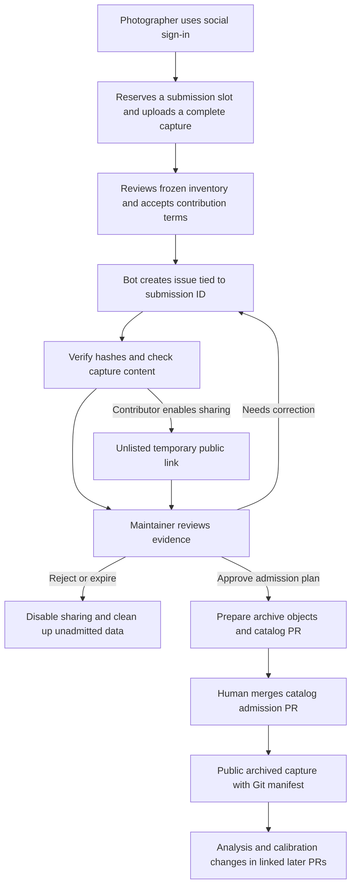
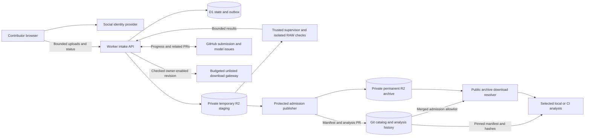

# ADR 0001: Community capture submissions and a reproducible sample catalog

- **Status:** Proposed; this PR is for discussion and must not be merged automatically.
- **Date:** 2026-11-01
- **Scope:** Contributor intake, visibility, catalog admission, storage and analysis provenance.
- **Repository:** `Niklas-labs/lightroom-pixel-shift-plugin`, including catalog metadata initially.
- **Implementation:** None in this ADR. Rollout requires the acceptance gates below.

## 1. Problem and intended outcome

A photographer should be able to contribute a capture without understanding camera
profiles, reverse engineering or Git, and without having a GitHub account.
Maintainers do the configuration and coding work. Contributions become a licensed,
reviewable corpus for investigating cameras and repeating validation as the engine changes.

A successful upload or public share is evidence to investigate, not camera support
or catalog admission. Samples can be useful before a decoder/profile exists. Failed
and inconclusive analysis must remain visible alongside successful results.

Separate **upload**, **public visibility**, **catalog admission** and **camera support**.
Photographers may share checked submissions before admission. Admitted captures are
public and preserved; unadmitted captures remain temporary even when shared publicly.
The portal is a submission/status tool. GitHub holds maintainer work; the portal does
not become a general discussion forum.

## 2. Requirements and how the proposal meets them

| Requirement | Proposed response |
| --- | --- |
| Photographers submit files, not implementation work | Browser flow: social sign-in, capture upload, license attestation and a status page. No GitHub account, fork, PAT or hand-written manifest. |
| Identity independent of the maintainer platform | Provider-independent social authentication maps to a stable portal principal. GitHub Apps create issues/PRs on the project's behalf. |
| GitHub tracks each submission and its follow-ups | One issue per submission ID, linked to a canonical model issue and all catalog/analysis/calibration PRs. The portal shows relevant progress. |
| No new discussion forum | Structured maintainer requests and bounded contributor corrections; no user-to-user messaging, public comment threads, feeds, voting or general chat. |
| Versioned, reviewable catalog | Git stores manifests, hashes, licenses and analysis history. Permanent R2 storage holds admitted original bytes and large reference/derived assets. |
| Fetch only the evidence a job needs | Resolve selected manifests at a pinned Git commit; fetch objects by SHA-256 and verify sizes/hashes. Ordinary builds do not fetch samples. |
| Publicly reusable contributions | Explicit `MIT OR Apache-2.0` grant and rights attestation for an exact immutable inventory. No private-use-only, research-only or noncommercial restrictions. |
| Public samples once admitted | A merged admission PR authorizes public downloads from the permanent archive. R2 bucket access itself remains private. |
| Optional sharing before admission | Contributor-controlled unlisted link after verification and content checks; no admission claim, listing, extra quota or retention extension. |
| Prevent general-purpose storage/hosting abuse | Sign-in, unadmitted count and byte caps, rolling creation/upload limits, restricted file/capture types, bounded sharing traffic, expiry and takedown controls. |
| Repeatable analysis without an AI agent | Pinned tools, immutable inputs and append-only Git run records. Maintainers initially dispatch workflows and review conclusions manually. |
| Recoverable operations and durable data | Persistent operational state, idempotent retries, reconciliation, separate staging/archive policies, independent backups and restoration tests. |

### Initial capture contract

Start with **one complete Sony 4-shot or 16-shot Pixel Shift sequence per submission**,
from a tripod, of a static scene with fine detail and useful tonal/color variation.
Require original, unmodified RAW bytes, a declared camera/model/mode and a short
capture checklist. Preserve the complete sequence rather than selecting its best frames.

An unsupported Sony model is a valid research candidate. Missing decoder support is
an analysis result. Malformed, incomplete or mixed sequences need correction before
normal admission. Other manufacturers, counts and motion-specific recipes remain
future intake extensions; this ADR does not implement their processing support.

Vendor-merged ARQ/DNG or lossless reference renders are optional additional evidence,
with tool/version/settings and their relationship to the original sequence. Do not
require paid reference software. No unrelated files, arbitrary archives, vendor
executables or extracted proprietary profiles are accepted. Oversized references
are omitted with a recorded reason, not silently resized or split. Missing reference
evidence may leave a validation claim unproven without invalidating the RAW submission.

A filename/extension or RAW-like header is insufficient for sharing eligibility.
Check actual content, metadata consistency, sequence completeness and bounded decoding
where supported. An unavailable decoder requires maintainer screening instead of an
automatic sharing pass. These filters reduce abuse; they cannot prove that every byte
in a photograph container is legitimate or that the contributor owns all rights.

## 3. High-level flow



### 3.1 What the photographer does

1. Follow **Contribute a capture**, use an enabled social sign-in provider, and choose
   the camera/mode. No GitHub account or repository permissions are required.
2. See available submission slots, byte limits and expiry; select the complete capture.
   Hash/upload incrementally with progress and resume. After reopening the browser,
   reselect files and match their hashes before resuming; filenames alone do not suffice.
3. Review the exact inventory and chosen public attribution, accept the license and
   publication terms, and submit. The receipt issue is public immediately; original
   files stay private unless sharing is enabled or the capture is admitted.
4. Follow the status page and answer specific correction requests there. File or
   relevant declaration changes create a new revision with renewed consent/checks.
5. Optionally choose **Share by link** after checks pass. The page states **Not yet
   admitted**, the absolute expiry, applicable download allowance and public license.
   Anyone with the link can read/download the checked inventory; it is not confidential.
6. Follow catalog admission and subsequent analysis/calibration PRs through the portal's
   links. Only admission grants permanent retention and ordinary public catalog access.

The issue is a **bot-authored project receipt** for the portal submission ID/revision,
with inventory/policy digests and selected attribution. It does not impersonate the
photographer or require their social-provider identifier to be published. At first,
client SHA-256 values are claims; independent server-side verification must match them
before sharing or admission can proceed. No R2 credentials or expiring URLs enter GitHub.

### 3.2 What the maintainer does

1. Triage the submission issue, link its model issue, and inspect usefulness, provenance,
   duplicate evidence, privacy/rights concerns and available budgets.
2. Dispatch trusted verification/analysis against the frozen revision; inspect private
   results and bounded previews. Request a specific correction or record a limitation.
3. Approve an exact admission plan: inventory and report digests, attribution/license,
   archive objects, base catalog commit, and proposed metadata/analysis changes.
4. Run the protected publisher; review and merge the catalog PR manually. The service
   then reconciles the merge and enables public archive access.
5. Track further analysis and proposed calibration/profile/code changes in linked PRs.
   One admitted capture does not establish every variant of a model's support.

An early share is an intentional public release under the contribution terms, not
maintainer endorsement or permanent hosting. Admission does not require early sharing.
Published metadata in a catalog PR is itself public even while underlying original
files remain private pending merge, unless their owner already enabled sharing.
Disabling a link or rejecting a capture cannot retract copies already downloaded.

### 3.3 Tracking without building a forum

Use **one canonical support issue per exact model**, and **one submission issue per
capture ID** across its revisions. Link both directions; link catalog and later
analysis/calibration PRs to the submission issue. Firmware, mode and compression
variants are evidence within a model, not separate labels per model.

GitHub is the maintainer workspace for triage and work in progress. Git is the formal
record of admitted identities, grants, analysis and support claims. D1 owns upload,
authentication, visibility, expiry, quotas and retry state. Relevant authorized issue
changes project into portal status; closing an issue or adding a label never means
that a catalog PR merged or independently authorizes admission.

The portal offers progress, linked PRs, and a small structured **Action needed** form:
confirm a setting, supply a missing file or answer one bounded question. Responses
are private to maintainers by default. Only an explicitly public, sanitized summary
is added by the bot to the issue. Do not mirror arbitrary GitHub comments, add threaded
portal discussions, or give contributors general-purpose posting/attachment endpoints.
Existing GitHub issue discussion can continue for people who choose to use GitHub.

The bot creates issues idempotently with stable repository/issue IDs and a generated
receipt marker. Model aliases/provisional identities are resolved through maintainer
review. An issue's ordinary portal status URL does not reveal an unlisted download
capability; the contributor chooses where to share that separate link.

## 4. Proposed decision

Use **Cloudflare Workers** for a focused submission UI/API, generic **social sign-in**,
**D1** for transactional operational state/outbox, and **R2** for two distinct storage
roles: temporary unadmitted uploads and permanent admitted originals/assets. Keep the
catalog manifests, licenses and analysis records in the **existing Git repository**.
Use project GitHub Apps for issues/PRs and initially maintainer-dispatched Actions
workflows for verification, analysis and admission.

Admitted captures are publicly downloadable. A verified, unadmitted revision may be
shared through an owner-enabled, expiring unlisted link under the same pending quota.
Neither sharing nor opening a PR grants admission or indefinite storage. No general
forum, automatic support promotion, automatic PR merge or AI agent is required.

## 5. Architecture and implementation boundaries



### 5.1 Identity, sessions and permissions

Authentication is independent of GitHub integration. Map a verified provider identity
`(issuer, subject)` to an internal portal principal; OAuth providers need an equivalent
provider-verified stable account ID. Do not trust display names or merge accounts by
matching names/emails. Linking identities requires authentication to both; linking or
unlinking must not reset quota/history. No specific social provider is mandated here.
Provider selection requires checking its supported protocol, availability and terms.

Use standards-based OAuth/OIDC libraries, state/nonce/PKCE as appropriate, strict issuer,
audience and redirect checks, short-lived secure HttpOnly SameSite session cookies,
CSRF/origin checks and reauthentication for stale sensitive sessions. Discard provider
API tokens after establishing identity unless a separately reviewed need requires
retention. Publish chosen attribution and a consent receipt ID; provider identifiers
stay private under an explicit retention policy. Sign-in is not proof of ownership
or a guarantee against multiple-account abuse.

The repository-installed **intake GitHub App** writes project receipt/status issues
with Issues write and necessary metadata read access. It has no general Contents
write token. A **separate publisher App** has scoped Contents/Pull requests write and
required reads, installed only on this repository. Its private key is available only
to the protected publisher through the existing OpenBao/GitHub OIDC pattern, with
policies separate from Apple signing. Intake cannot obtain it or archive write access.

Maintainers authenticate with GitHub for review actions: an allowlisted numeric ID
and a fresh maintain/admin permission check are required. Social contributor sign-in
never grants maintainer permissions. Check GitHub webhook signatures over raw bodies,
installation/repository IDs and delivery IDs. Issue text, labels and uploader claims
are not admission authority. Contents tokens are not path-scoped by GitHub; publisher
diff restrictions, protected environments/branches and human review remain necessary.
Neither App can bypass review or directly publish a default-branch catalog change.

### 5.2 Uploads and immutable revisions

Initially stream bounded multipart parts through the authenticated Worker to R2.
A proposed 32 MiB part size must fit the deployed ingress limits. Enforce declared
and actual lengths with streaming/backpressure; never buffer whole files. Reserve
submission slots, bytes and allowed part numbers transactionally before accepting
bodies. Use generated file/object IDs, current part leases and bounded concurrency.
Reconcile failed/replaced parts against R2 before retrying. The browser hashes
incrementally and stores no credentials in browser storage.

On submission, stop new leases, drain/cancel in-flight operations, complete the exact
inventory, check actual sizes and freeze the revision. No route can replace frozen
bytes. Its inventory digest is SHA-256 of UTF-8 canonical JSON (RFC 8785), with files
ordered by server-issued ID and a versioned schema for hashes/sizes, declarations,
principal/consent receipt and policy-text digest. Changed inventory/consent creates a
new revision; it does not retain stale verification, sharing or approval. Multipart
ETags are not full-file SHA-256. Independently hash every file before eligibility.

Prototype short/oversized bodies, late requests, cancellation, timeouts and browser
resume against deployed R2. A browser success response alone is not storage proof.
Direct presigned browser uploads can be evaluated later after demonstrating equivalent
quota, expiry and freeze controls. No arbitrary URL imports, ZIP upload or generic
object-write/list endpoint is part of intake.

### 5.3 Admission state and public visibility are separate

| Lifecycle | Meaning |
| --- | --- |
| `draft` / `uploading` | Private inventory within an unadmitted slot and reserved bytes. |
| `submitted` / `needs_information` | Frozen revision and receipt issue; checks/corrections pending. |
| `verified` | Byte hashes match; a versioned report records content checks and limitations. |
| `approved_for_admission` / `preparing_pr` | Authorized maintainer approves the exact plan; leased archival preparation/publication. |
| `pr_open` | Catalog PR exists; still unadmitted, with a recorded plan/commit/object inventory. |
| `admitted` | Catalog PR merge is reconciled and public archive access is enabled. |
| `rejected` / `withdrawn` / `expired` | Disable temporary sharing, close pending admission work and clean up unadmitted bytes. |

Visibility is separately `private`, `unlisted`, or `catalog_public`. Private is the
default. Only a frozen, hash-verified revision passing content screening can become
unlisted on its owner's explicit request. Initially the maintainer-dispatched verifier
performs these checks; the sharing toggle may show **Waiting for checks**, not promise
instant publication. Unsupported decoding needs a recorded maintainer screening
exception, not an automatic pass. Admission makes the capture catalog-public regardless
of whether it was previously shared. Admission is not camera-support validation.

An unlisted link has a high-entropy, revocable capability bound to one revision and
inventory. It is anonymous public access for anyone possessing it, not authentication.
Expose only the approved capture files and bounded capture metadata/previews; label
its unadmitted status and expiry. There is no public pending-submission directory or
feed. `noindex` discourages indexing but provides no secrecy. Do not publish the
capability automatically in the GitHub issue, access logs or referrers.

Sharing neither releases a pending slot nor increases byte allowance/retention.
Views, link rotation, new revisions, resubmission of duplicate content and an open
catalog PR do not renew the absolute pending lifetime. Disabling sharing, rejection,
withdrawal, expiry or a takedown stops new downloads. Do not promise erasure of prior
copies or reversal of grants already made. Sharing requires explicit publication
consent/license before enabling the link; admission consent alone cannot be treated
as permission for an earlier public share.

Temporary downloads stream through a budget-enforcing gateway. Reserve/check bytes
and requests before serving; validate ranges, count concurrent reads and conservatively
account for interrupted transfers. Do not redirect temporary links to reusable R2
signed URLs or cache their bodies outside this gateway: that would bypass revocation
and traffic accounting. Already admitted public objects use the archive resolver,
not an alternate path to unadmitted objects known only by hash.

### 5.4 Verification and admission jobs

Verification runs trusted pinned code from a protected default-branch workflow,
initially dispatched by maintainers. A run-scoped OIDC lease checks issuer, audience,
repository ID, workflow ref (`workflow_ref` and reusable `job_workflow_ref` where
applicable), event, run identity and expiry. Fork/PR tokens and other workflows fail.
The supervisor downloads only that inventory, verifies it, and runs RAW inspection
in a disposable, unprivileged sandbox with no network, credentials, OIDC capability,
Docker socket or writable code mount. Bound CPU, memory, disk, runtime and outputs.
Never execute contributed code, metadata, scripts or dependencies.

This is a public Actions repository. Private originals, detailed reports, decoder
stderr and previews must not enter public logs, workflow artifacts or shared caches.
Return bounded structured output to a run-scoped intake endpoint; it cannot overwrite
input files or another run's results. Public logs show opaque IDs/coarse outcomes.
Unsupported formats, parser crashes and inconclusive findings are explicit outcomes.
Checks and human screening mitigate arbitrary-storage abuse but cannot prove rights.

The protected **admission publisher** rechecks current maintainer authority, exact
inventory/report/plan digests, budgets and expiry. It rehashes bytes, without RAW
parsing, and prepares content-addressed archive objects and a narrow metadata PR.
The immutable plan binds base catalog commit, tool/template revisions, exact Git
paths/content hashes, asset digests, grant and public reports. Display it before
protected-environment approval; regenerate/compare it after any wait. Changed plans
need fresh review. Branch creation uses the publisher App so ordinary PR checks run;
do not rely on recursive triggers from `GITHUB_TOKEN`. Pin Actions/container images,
forbid untrusted `pull_request_target` checkout, and require human/CODEOWNER review.
Sample admission diffs cannot modify engine/profile/workflow code.

A pending PR does not make its originals catalog-public or permanent. Before merge,
checks verify archive objects and an active admission lease. Expired/rejected PRs
must be closed and their admission checks invalidated before orphan cleanup. Confirm
current GitHub merge state and admitted Git references before deletion; if these
cannot be established, defer deletion and pause new intake when capacity is exhausted.
Already admitted objects cannot be collected by a pending-submission cleanup operation.

After merge, a verified webhook/reconciler projects the admitted object allowlist from
trusted Git into the public resolver. Index updates are retryable; show a transient
publication state until objects are resolvable. Never accept an uploader's arbitrary
commit/branch as evidence of admission. Catalog history retains previously admitted
hashes needed for pinned older runs, subject to explicit takedowns.

### 5.5 Storage, catalog schemas and selective fetching

Use distinct private **staging** and **archive** buckets, with separate credentials
and lifecycle rules. Only admitted archive objects have indefinite retention. Objects
prepared for an unmerged PR remain candidate data under the unadmitted ledger and
cleanup policy. Public-facing intake cannot write/delete archive objects or provide
a general object browser. Do not apply staging expiry rules to the archive.

Archive paths are content-addressed, for example `sha256/<digest>`. Use create-only
writes; an existing key is reused only after matching size/hash. Preserve originals,
not silently normalized/transcoded replacements. A stable read-only download resolver
serves only admitted hashes and maps them to storage; it does not fall back to staging.
A storage migration changes location mappings, not historical file identity. Expiring
access tokens and provider-specific bucket URLs do not belong in Git manifests.
Deploy the read-only resolver independently of intake/social authentication, with a
reconstructible Git-derived admission index; intake or identity-provider outages
must not stop admitted public downloads.

Proposed Git layout (examples only):

```text
samples/
  README.md
  schemas/{capture,analysis-status,analysis-run}.schema.json
  licenses/{policy-v1.md,MIT.txt,Apache-2.0.txt}
  sony/ilce-7cr/<capture-id>/
    manifest.yaml
    LICENSE.txt
    analysis/status.yaml
    analysis/runs/<run-id>/{run.yaml,results.json,review.md}
```

Manifests record schema/capture/revision IDs, each asset's SHA-256, byte size, logical
filename and role, declared/observed camera facts, reference provenance, license,
public attribution/consent receipt, and stable repository/submission/model issue IDs.
Large references/previews are archive assets too. Upload slots are not inferred shot
indices. Keep provider identity details private; do not require a GitHub submitter ID.
Use strict YAML/JSON Schema and cross-record validation; reject duplicate/unknown
fields, unsafe tags, non-finite values and unsafe paths. Rust follows the project's
`serde-saphyr` conventions. CI rejects RAW blobs accidentally added to Git. No Git
LFS setup is required for this catalog.

The contributor grants both MIT and Apache-2.0, allowing recipients to choose either,
for the exact inventory; preserve policy version/text digest, notice and attribution.
The root code-license transition remains a separate change. This ADR does not relicense
existing material. Intake/sharing cannot launch before full policy/license wording is
reviewed and merged. Grants/bytes are immutable; factual corrections and replacement
revisions receive explained PRs, never a silent rewrite of old evidence.

A small fetch tool reads selected manifests at a pinned catalog commit, resolves the
hashes, downloads only those assets, verifies every size/SHA-256, and caches by digest.
Support capture/model selection, interrupted downloads and offline use of verified
cached files. Logical output paths come from validated manifests, never arbitrary
remote filenames. Missing or tombstoned objects fail clearly; never substitute the
latest capture or silently use incomplete data. A Git checkout alone does not fetch
RAWs; reproducibility depends on preserving the external objects as well as metadata.
This tool must work without an intake login for admitted public captures.

Normal engine/plugin CI fetches no samples. Catalog PRs run cheap metadata/integrity
checks; full analysis selects explicit captures and is budgeted. Sample-only merges
should not rebuild/sign the plugin or bundle RAWs into plugin/source ZIPs. Coordinate
path filters with required-check reporting so skipped jobs do not block valid PRs.

### 5.6 Analysis and calibration history

`analysis/status.yaml` summarizes `needs_analysis`, `blocked_decoder`, `inconclusive`,
`profile_proposed` or `validated_for_claims`, with run IDs and exact supported claims:
mode, compression/firmware/ISO range, crop, normalization, color, detail, motion,
RAM/disk parity and Lightroom host acceptance where actually tested.

Each run adds immutable input manifest/asset digests, input catalog commit, engine/
profile/tool/container revisions, commands, parameters, resource measures, results
and a human `review.md`. Append failed/inconclusive runs too. Manual Sony/Lightroom
comparisons identify versions/settings and unavailable evidence. Initial intake runs
record their existing base catalog commit and frozen inventory digest, not the unknown
SHA of the future commit containing that run. Rejected temporary inputs are not
promised indefinitely reproducible after expiry.

Further analysis/calibration changes get PRs linked to the submission and model issues.
Git records formal conclusions; issues track ongoing work and the portal projects
progress. Measurements cannot establish ownership, subjective quality, all camera
variants or untested Lightroom behavior. Human reviewers decide support changes;
AI assistance is optional and never admission authority.

### 5.7 Budgets, abuse prevention and retention

Proposed configurable defaults, to review in this PR:

| Limit | Initial proposal |
| --- | --- |
| Unadmitted count | 2 submissions per portal principal, including uploading, queued, shared and PR-open captures |
| Per-file size | 4 GiB; independent of GitHub's storage plan and below configured storage/transfer limits |
| Per-submission allowance | 16 GiB / 24 files across all retained revisions, including references/previews |
| Creation/upload rate | 4 new submissions and 32 GiB actually uploaded, including retries, per rolling 7 days per principal; deletion/admission does not reset counters |
| Global unadmitted data | 64 GiB across staging, archive candidates and generated assets; reserve 16 GiB of this for admission-copy headroom, unavailable to new uploads |
| Upload parts | 32 MiB; at most 2 concurrent parts per submission, plus a finite global limit |
| Temporary shared downloads | 32 GiB authorized transfer per rolling 24 hours per submission; at least one complete permitted inventory must fit |
| Global temporary sharing | 128 GiB authorized transfer per rolling 24 hours, plus finite request/concurrency caps |
| Incomplete upload lifetime | 24 hours, backed by multipart-abort cleanup |
| Unadmitted completed-data lifetime | 30 days absolute from first completed upload; sharing, revisions and PRs do not refresh it |
| Admission approval lifetime | 7 days for the same plan; expiry blocks publication until renewed |
| Admitted data | No automatic expiry; preservation, integrity and backup policy below applies |

A slot remains occupied until admission is reconciled or deletion is confirmed; a
queued deletion or hidden/rejected record cannot immediately free capacity for more
bytes. Admission releases a pending slot but consumes the separate permanent-storage
budget. Retained old revisions and unmerged archive candidates count toward pending
bytes; physical deduplication must not give a user unlimited logical submissions.
Reserve space for copies before archival preparation, and initially run one publisher
at a time so a full upload allowance cannot deadlock admission. Remove redundant
staging copies after archive verification and expiry of any active read leases.
Historical duplicate hashes identify resubmission attempts; repeating expired/rejected
content does not automatically extend hosting. Legitimate exceptions require a
recorded maintainer override, finite allowance and explicit expiry.

Use atomic quota reservations and revision checks, server-measured bytes and leases.
Add per-IP/account request limits and a challenge if necessary. Multiple providers
or fresh accounts do not prove distinct people: global storage, job and traffic caps
remain necessary. Set finite global verification minutes, job concurrency, archive
storage and serving-request budgets before launch. Fail closed at capacity; explain
**Limit reached** or **Link expired** rather than silently retaining/serving data.
Finite caps protect the service; they do not guarantee availability under deliberate
quota exhaustion. Warn operators and preserve room for cleanup/recovery work.

Temporary sharing is for capture review, not generic hosting. Only screened frozen
inventories can be served; no arbitrary extra objects, URL fetches or public upload
endpoints. Traffic counters follow the submission across links and revisions, so link
rotation does not reset them. Limit/validate range requests and do not expose a bypass
through raw R2 URLs. Disable a reported abusive share promptly and retain a bounded
moderation receipt. No storage/traffic/expiry privilege is gained by enabling sharing.

R2 lifecycle rules backstop staging cleanup. Warn before expiry, then disable sharing,
settle pending PRs and delete confirmed unadmitted data. On uncertain merge/deletion
state, retain the bounded reservation and investigate; do not risk an admitted object.
There is no promise to preserve a temporary share because it was popular or reviewed.
Social sign-in plus quotas/content screening reduces abuse; it cannot eliminate it.

### 5.8 Preservation, privacy and operations

Admitted captures are the permanent corpus. Protect archive credentials, use write-once
application semantics, monitor integrity, and keep an independently restorable copy
with separate credentials/failure boundaries. Backup deletions must not blindly mirror
source deletions. Backup selection follows the admitted inventory; candidates do not
inherit indefinite backup retention. Schedule inventory/hash checks and actual restore tests. Provider
durability and Git hashes are not backups; if a missing object cannot be restored,
record that loss explicitly instead of claiming the historical run still reproduces.
The accepted catalog and resolver/fetch protocol must remain usable if intake is down.

R2 Standard charges storage/operations and currently has no egress bandwidth fee;
Workers, serving operations and backups still need budgets. Avoid making GitHub LFS
storage/download quotas a runtime dependency for the public corpus. Keep asset identity
independent of storage location so migration or additional mirrors remain possible.

Before upload and again before early sharing, explain possible embedded GPS, serials,
faces and third-party material. Do not scrub original bytes silently or promise that
scanning proves publication rights. Public metadata/reports use reviewed allowlisted
fields. Retain only necessary private identity/audit data and redact secrets, session
information and share capabilities from telemetry. Serving originals uses attachment
headers and controlled MIME types; previews are bounded raster images, not HTML/SVG.

Before any public release, withdrawal removes temporary data after cleanup. After an
early share or admission, disable current access where appropriate but be honest about
public copies and prior license grants. Admitted removal/takedown is maintainer work:
serve an explicit tombstone, preserve historical identity/reason in a reviewed record,
and apply the retention/legal policy. Urgent access suspension may precede its audit
PR; it must not silently mutate original bytes or be overridden by a stale public cache.

Back up D1 and keep infrastructure, policies, schemas and tools in Git. Alert on quota
pressure, expired/stale leases, outbox/cleanup failures, unusual sharing traffic,
parser crashes, archive integrity loss and GitHub/R2 outages. Reconcile issued operations
with external state: issue/PR creation after a lost response finds its generated marker
before retrying; webhook IDs deduplicate deliveries. Resolve rare duplicates explicitly
rather than assuming distributed exactly-once execution. Never force-push over a
user-edited admission PR; regenerate a conflicting plan for review.

## 6. Alternatives and consequences

| Alternative | Reason not chosen initially |
| --- | --- |
| Require GitHub contributor accounts or direct PRs | Adds friction unrelated to providing photographs. Social identity and project-created issues preserve traceability. |
| GitHub-hosted LFS for the corpus | Convenient Git tooling, but public downloads/versioned large objects consume owner storage/bandwidth allowances. R2 plus Git manifests separates those concerns. |
| An R2-backed custom LFS server | Could preserve LFS tooling, but adds a transfer/auth service we do not need for selective manifest-based downloads. Keep it a future adapter. |
| GitHub Release assets or issue attachments | Awkward intake/versioning/large resumable transfers; do not replace reviewed manifests and immutable archive objects. |
| Make every upload public automatically | Publishes unreviewed material without a deliberate contributor choice. Private-by-default with optional screened unlisted sharing meets both needs. |
| Keep shared submissions indefinitely | Creates an unmoderated file host and bypasses admission. Pending limits and expiry apply regardless of visibility. |
| Mirror all comments into the portal | Turns a focused intake tool into a second forum with moderation/synchronization obligations. Use structured corrections and progress. |
| One public Worker with repository/archive write authority | Increases compromise scope. Separate intake, admission and read-only serving capabilities. |
| Direct presigned upload/temporary-download URLs | Upload controls need proof; temporary download URLs would bypass the chosen gateway accounting/revocation. |
| Entire analysis in Workers or automatic AI admission | Native RAW workloads and human evidence/rights decisions need different boundaries. Use bounded jobs and human-reviewed PRs. |

The costs are a small identity/intake service, object preservation/backups, a fetch
tool and bounded serving/cleanup operations. Git alone no longer contains the RAWs.
The benefit is a low-friction contributor flow and public corpus without coupling
its large-file traffic to GitHub LFS. Neither social accounts nor early sharing turn
an unadmitted upload into permanent accepted evidence.

## 7. Implementation sequence and acceptance gates

1. **Policy and storage contract:** review this ADR; adopt grants/terms, versioned
   schemas, social identity/receipt policy, content IDs, resolver/fetch protocol and
   issue/PR conventions. Manually archive/admit one known capture in a PR and restore
   it from backup. No community intake until this works.
2. **Invite-only pilot:** build focused portal, social sign-in, intake App, D1, staging,
   multipart/resume, freezing, quotas and cleanup. Manually dispatch verification and
   protected admission. Keep provider-specific choices out of the catalog format.
3. **Optional sharing:** prove screening/consent, revocation, expiry and byte/request
   accounting before enabling temporary public links. No discussion/forum features.
4. **Repeatable analysis and open intake:** pin inputs/tools, generate linked analysis/
   calibration PRs, prove selective/offline fetching and failure recovery, then open
   authenticated community intake with finite global budgets and a takedown runbook.

Before public rollout, demonstrate:

- A contributor without GitHub can submit complete 4/16-shot captures, answer a bounded
  correction request, and follow submission/model/catalog/calibration links. Account
  linking does not reset limits; provider display names cannot impersonate principals.
- Interrupted uploads resume without whole-file buffering. Wrong sizes, hashes, mixed
  captures, arbitrary files and late writes fail; unsupported decoding is an explicit
  outcome requiring screening before sharing or justified research admission.
- Private uploads cannot be downloaded anonymously. Verified owner-enabled links can,
  while showing unadmitted status and expiry. Disabling/expiring/rejecting them blocks
  new access, including cached/range/bypass paths, without promising to recall copies.
- A third pending capture is blocked at the proposed limit. Sharing, link rotation,
  new revisions, cancel/recreate, account linking and opening a PR cannot bypass count,
  byte, rolling-rate or traffic limits. Cleanup failures retain reservations.
- RAW parsing has no secrets, network or write authority. Public Actions logs/artifacts/
  caches contain no private bytes, detailed metadata or share capabilities.
- An admission PR matches its approved plan and archive hashes. It cannot self-merge;
  an expired plan or missing object blocks readiness. Sharing does not authorize merge.
- After merge, originals are publicly resolvable without sign-in. Before merge, guessing
  a hash/branch cannot expose private objects. Replay events and interrupt indexing:
  one logical admission converges, and orphan cleanup never deletes admitted data.
- Fetch one capture/model at an older pinned commit, verify all bytes, and reproduce
  a run without downloading other models. Git/package ZIPs contain no RAW payloads.
- Expire/close an unmerged PR, withdraw a shared capture, exhaust a quota, revoke an
  App, and simulate GitHub/R2/identity-provider outages. Outcomes and recovery are clear.
  Restore an admitted capture from independent backup and test tombstone behavior.

## 8. Review points for this PR

1. Generic social sign-in, project-created GitHub issues and a focused status/correction
   portal, with no GitHub account requirement or new discussion forum.
2. Permanent R2 originals with Git manifests/analysis and selective hash-based fetching,
   independent preservation, and public access upon admission.
3. Optional screened unlisted sharing before admission, with deliberate consent,
   unchanged pending quotas/expiry and budget-enforcing downloads.
4. Proposed two-pending-submission limit, byte/rolling-rate/global caps and retention
   values; exceptions require explicit finite maintainer overrides.
5. Separate intake/admission permissions, manual trusted jobs, exact-plan PR review
   and explicit MIT/Apache-2.0 sample grants; no automatic AI/support decisions.

## References

Platform references checked 2026-11-01; deployment must recheck applicable limits.
The architecture/policy choices above are proposals, not vendor guarantees.

- [Workers limits](https://developers.cloudflare.com/workers/platform/limits/) and
  [streaming guidance](https://developers.cloudflare.com/workers/best-practices/workers-best-practices/).
- [R2 multipart API](https://developers.cloudflare.com/r2/api/workers/workers-multipart-usage/),
  [S3 compatibility](https://developers.cloudflare.com/r2/api/s3/api/),
  [presigned capability semantics](https://developers.cloudflare.com/r2/api/s3/presigned-urls/),
  [lifecycle cleanup](https://developers.cloudflare.com/r2/buckets/object-lifecycles/),
  and [R2 pricing](https://developers.cloudflare.com/r2/pricing/).
- [GitHub webhook verification](https://docs.github.com/en/webhooks/using-webhooks/validating-webhook-deliveries),
  [Actions secure use](https://docs.github.com/en/actions/reference/security/secure-use),
  and [Git LFS billing](https://docs.github.com/en/billing/concepts/product-billing/git-lfs).
- [RFC 8785 canonical JSON](https://www.rfc-editor.org/rfc/rfc8785) for stable digest inputs.
- Project [profile conventions](../camera-profiles.md),
  [validation requirements](../validation.md), and [roadmap](../../ROADMAP.md).
